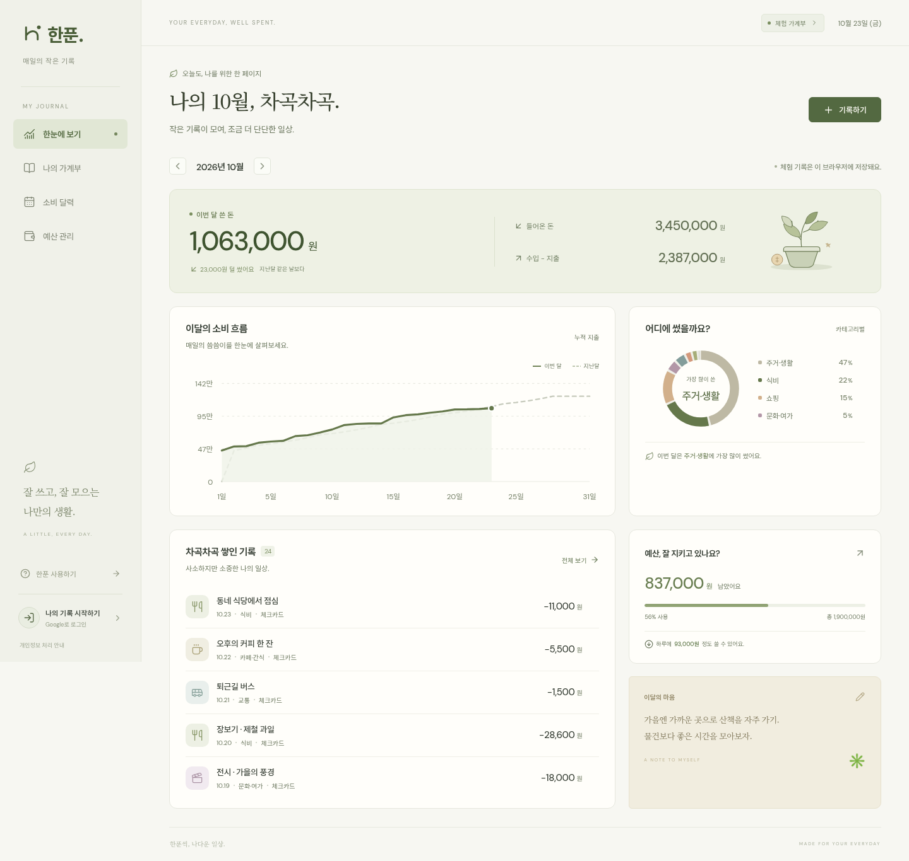

# 한푼

잘 쓰고, 잘 모으는 나만의 생활. 크림색 종이, 올리브색 잉크, 차분한 한글 명조를 바탕으로 만든 개인 가계부입니다.



[모바일 화면 보기](docs/preview-mobile.png)

## 할 수 있는 일

- Google 계정 로그인과 계정별 클라우드 저장
- 수입·지출 추가, 수정, 삭제 및 카테고리·결제 수단·메모 기록
- 월별 누적 지출 비교와 카테고리별 소비 비율
- 날짜별 소비 달력과 원하는 날짜에 기록 추가
- 카테고리별 월 예산과 이달의 메모
- 내용 검색, 수입·지출/카테고리/결제 수단 필터, 페이지 나누기
- 검색 결과 또는 월별 전체 기록을 한글 CSV로 내보내기
- 로그인 전 이 기기 가계부, 모바일 하단 메뉴, 키보드로 사용하는 대화상자

이 기기의 기록은 브라우저에만 저장됩니다. 로그인하면 해당 계정의 가계부가 열리며, 이 기기의 기록을 자동으로 업로드하지 않습니다.

## 실행

Node.js 24를 권장합니다. 최소 버전은 22.12입니다.

```bash
npm ci
npm run dev
```

개발 주소는 `http://localhost:5173`입니다.

```bash
npm test
npm run build
npm run preview
```

React 19 · TypeScript · Vite · Supabase Auth/Postgres · Lucide를 사용합니다. 데이터 시각화는 별도의 차트 라이브러리 없이 SVG로 구성했습니다.

## Supabase 연결

선택한 서울 프로젝트(`dbneonomwrqwlbitwdtr`)의 **공개용 publishable key**가 기본 설정에 포함되어 있어 바로 연결됩니다. 이 키는 비밀 키가 아니며, 모든 데이터 접근 권한은 데이터베이스의 RLS로 결정됩니다. `service_role` 또는 secret key는 프런트엔드에 넣으면 안 됩니다.

다른 프로젝트를 사용하려면 `.env.example`을 `.env.local`로 복사하고 다음 값을 지정하세요.

```dotenv
VITE_SUPABASE_URL=https://your-project.supabase.co
VITE_SUPABASE_PUBLISHABLE_KEY=sb_publishable_your_key
```

데이터베이스 정의는 [가계부 마이그레이션](supabase/migrations/20261023141951_hanpun_ledger.sql)에 있습니다. 선택한 서울 프로젝트에는 이미 적용했습니다. 기존 프로젝트의 다른 테이블이나 인증 설정을 덮어쓰지 않고, `hanpun_transactions`와 `hanpun_monthly_plans`만 사용합니다.

새 Supabase 프로젝트에는 이 SQL을 SQL Editor에서 실행하거나 Supabase CLI로 연결한 뒤 마이그레이션을 적용하세요. 기존 프로젝트에 연결할 경우 해당 프로젝트의 마이그레이션 이력을 먼저 확인해야 합니다.

### Google OAuth

선택한 프로젝트에는 Google provider가 이미 활성화되어 있습니다. 다른 프로젝트에 연결한다면:

1. Google Cloud에서 웹 애플리케이션 OAuth 클라이언트를 만들고, 승인된 리디렉션 URI에 `https://<project-ref>.supabase.co/auth/v1/callback`을 등록합니다.
2. Supabase → Authentication → Sign In / Providers → Google에 Client ID와 Client Secret을 설정합니다. **Client Secret은 Supabase에만 저장합니다.**
3. Supabase → Authentication → URL Configuration → Redirect URLs에 다음을 추가합니다.
   - `http://localhost:5173/auth/callback/`
   - `https://<배포 도메인>/auth/callback/`
   - Cloudflare에서는 `https://<프로젝트명>.pages.dev/auth/callback/` 또는 실제 커스텀 도메인의 `/auth/callback/`
4. Google의 OAuth 동의 화면이 테스트 상태라면 실제로 사용할 계정을 테스트 사용자에 추가합니다.

기존 앱과 Supabase 프로젝트를 함께 사용한다면 기존 Site URL을 바꾸지 말고, 한푼의 콜백 주소를 Redirect URLs 목록에 추가하세요. 인증은 PKCE S256을 사용하며, 로그인 콜백의 코드 교환과 세션 갱신은 Supabase SDK가 처리합니다.

## 배포

### Cloudflare Pages

Cloudflare → **Workers & Pages → Create application → Pages → Import an existing Git repository**에서 `k435760-cyber/money`를 선택하고 아래와 같이 설정하세요.

| 항목               | 값                   |
| ------------------ | -------------------- |
| 프로덕션 브랜치    | `main`               |
| 빌드 명령          | 비워두기             |
| 빌드 결과 디렉터리 | `dist`               |
| 루트 디렉터리      | 저장소 루트 그대로   |
| Node.js            | `24` (`.nvmrc` 포함) |

완성된 **정적 HTML·JS·CSS를 `dist`에 포함**했습니다. `wrangler.toml`이 배포 폴더를 `dist`로 지정하므로 Cloudflare에서 별도 빌드 없이 그대로 공개할 수 있습니다. 저장소의 소스용 `index.html`이 아닌 `dist/index.html`이 배포됩니다.

화면이나 기능의 소스를 수정한 경우에는 로컬에서 `npm run build`를 실행한 뒤 변경된 `dist`도 함께 커밋하세요. GitHub Actions가 소스와 정적 파일이 일치하는지 검사합니다. Cloudflare의 빌드 명령을 `npm run build`로 설정해 호스팅 시 다시 빌드하는 방식도 지원합니다.

요청한 Supabase URL과 공개용 publishable key가 정적 파일에 포함되어 있으므로, 현재 프로젝트를 사용할 때 별도의 환경 변수를 추가할 필요가 없습니다. 다른 프로젝트를 사용한다면 `.env.local`의 `VITE_*` 값을 변경하고 로컬에서 `npm run build`를 실행한 뒤 `dist`를 함께 커밋하세요. Cloudflare에서 직접 빌드하는 방식을 선택한 경우에는 Cloudflare 빌드 환경 변수를 사용할 수도 있습니다.

배포 도메인이 정해지면 [Supabase URL Configuration](https://supabase.com/dashboard/project/dbneonomwrqwlbitwdtr/auth/url-configuration)의 **Redirect URLs**에 아래 주소를 추가하세요.

```text
https://<실제 배포 도메인>/auth/callback/
```

기존 프로젝트의 Site URL은 변경하지 않아도 됩니다. Google 로그인 후 이 주소로 복귀합니다. 정적 콜백 페이지 `dist/auth/callback/index.html`은 빌드할 때 자동으로 생성됩니다. Cloudflare에서 사용하는 응답 헤더는 `public/_headers`에 있습니다.

직접 업로드 방식이라면 저장소에 포함된 `dist` 폴더의 내용을 업로드하면 됩니다. GitHub 연동에서는 `main`의 정적 파일을 자동 배포합니다.

## 데이터와 보안

- 금액은 정수 원 단위로 저장하며, 기록 한 건은 1~9,999,999,999원입니다. 예산은 0원부터 설정할 수 있습니다.
- 두 테이블 모두 RLS를 활성화하고 `auth.uid() = user_id` 조건을 SELECT/INSERT/UPDATE/DELETE에 적용합니다. 소유자를 다른 계정으로 바꾸는 것도 차단합니다.
- 익명 사용자는 클라우드 가계부 테이블에 접근할 수 없습니다.
- Cloudflare 응답에 CSP를 적용해 자체 스크립트, Google Fonts, 지정된 Supabase 연결만 허용합니다. 인라인 스크립트, 외부 이미지·통신, 프레임 삽입, 외부 폼 전송을 제한합니다. 차트의 동적 스타일 속성과 첨부 이미지 미리보기는 허용합니다. Supabase 프로젝트 주소를 바꾸면 `public/_headers`의 허용 주소도 함께 바꿔야 합니다.
- 응답은 HTTPS 사용, 참조 URL 비공개, 창·리소스 분리를 적용하며 로그인 콜백은 캐시하지 않습니다.
- CI에서 `npm audit --audit-level=high`로 알려진 고위험·치명적 의존성 취약점을 검사합니다.
- Supabase의 응답 제한으로 내역이 누락되지 않도록 1,000개씩 끝까지 조회한 후 합산합니다.
- CSV는 UTF-8 BOM, 인용부호와 줄바꿈 처리, 수식 실행 방지를 포함합니다.
- 계정별 데이터와 기기 저장 데이터는 분리하며, 계정 전환 시 이전 계정의 기록을 화면에 노출하지 않습니다.

검증 내역은 [검증 기록](docs/verification.md)에 정리했습니다.

### 소비 도우미와 영수증 읽기

상단의 제공된 말풍선 아이콘으로 한푼 소비 도우미를 엽니다. Gemini 3.5 Flash-Lite가 선택한 달의 실제 수입·지출·카테고리 예산을 바탕으로 소비를 돌아보고, 텍스트 또는 JPG/PNG/WebP 영수증에서 기록 후보를 만듭니다. 사진은 전송 전 최대 1,800px로 줄이며 15MB 이하 파일을 지원합니다. 후보는 자동 저장하지 않고 기존 기록 폼에 미리 채워 검토·수정한 뒤 저장합니다. 날짜·금액이 불명확한 항목과 기존 기록의 중복 가능성을 표시하며, 미래 날짜는 제외합니다.

- 정적 Cloudflare 배포 방식을 유지하고, AI 요청만 Supabase Edge Function `hanpun-ai`로 처리합니다.
- Gemini 키는 Supabase Vault의 `hanpun_gemini_api_key`에 암호화하여 보관합니다. 저장소·정적 파일·브라우저에 포함하지 않습니다. 서버 설정 시 같은 이름의 Vault secret을 생성해야 합니다.
- `supabase/functions/hanpun-ai/`에 배포 소스, `20261023155548_hanpun_ai_assistant.sql`에 서버 전용 권한과 사용량 제한이 있습니다. 함수의 `verify_jwt`는 `false`이며 본문에서 앱 API 키를 검사하고, 로그인 토큰은 Auth `getUser`로 검증합니다. 게스트도 제한된 범위에서 이용할 수 있습니다.
- 일일 요청 한도는 게스트 IP 해시 기준 10회, 로그인 계정 기준 50회, 서비스 전체 200회입니다. 요청 사이 최소 3초를 두고, 사용량 기록은 최대 3일만 보관합니다. IP 기반 제한은 공유 네트워크에도 적용됩니다. 모델 호출에 실패해도 요청 횟수가 소비될 수 있습니다.
- AI는 가계부 테이블을 직접 읽거나 수정하지 않습니다. 사용자가 요청할 때 화면의 월별 요약·최근 최대 30개 기록의 날짜·내용·금액을 Google Gemini로 전송합니다. 계정 이메일·개별 메모는 요약에서 제외하며 이미지와 대화는 한푼 서버에 저장하지 않습니다.
- Google의 모델 응답은 신뢰하지 않는 입력으로 처리하고, 저장은 기존의 금액·날짜·계정별 접근 검사를 거칩니다.


### 개인정보 처리방침

`/privacy/`에서 수정된 개인정보 처리방침의 전문을 스크립트 없이 읽을 수 있습니다. 사이트 하단·사이드바·로그인 화면에서도 같은 내용을 자체 모달로 제공합니다. 실제 운영 기능에 맞춰 보관 기간과 처리 제공자를 수정한 16개 조항 및 표를 `src/content/privacy.json`에서 관리합니다. 책임자 등 아직 확인되지 않은 항목은 작성 안내로 남겨두었습니다. 수정된 PDF도 `/privacy-policy.pdf`에서 내려받을 수 있습니다. 정책을 바꿀 때는 이 PDF도 함께 갱신해야 합니다. 정적 페이지는 빌드 후 `scripts/prepare-static.mjs`가 생성합니다.


### 보험금·할부·기타 분류

- 지출의 `보험료`, 수입의 `보험금`을 분리해 합산합니다.
- `기타`(수입은 `부수입`)를 누르면 자체 모달에서 1~40자의 분류 이름을 입력합니다. 기존 기타 기록은 그대로 열리며 수정 시 이름을 입력할 수 있습니다.
- 할부는 총액·개월·이번 회차를 별도로 저장하고 **이번에 납부한 금액만 지출에 합산**합니다. 분할 계산의 원 단위 나머지는 마지막 회차에 더합니다. 실제 청구액은 직접 수정할 수 있으며 이자를 추측하지 않습니다. 미래 회차를 자동 생성하지 않습니다.
- CSV에 기타 분류와 할부 정보도 포함됩니다. 기존 기록과 8개 카테고리 예산은 보험료 예산 0원을 보완해 호환합니다.

### 보관 기간 확인

탈퇴 후 30일, 접속 로그 3개월, 분쟁 기록 3년을 저장하는 한푼 기능은 존재하지 않아 해당 보장 문구를 수정했습니다. 운영 DB의 삭제는 즉시 반영되고, 삭제된 내부 복제본은 삭제 후 최대 7일, 외부 파일은 생성 후 최대 7일 보관하므로 삭제 정보의 외부 백업 최종 만료는 삭제 후 최대 14일이 걸릴 수 있습니다. AI 이용량 기록은 최대 3일이며 `hanpun-retention-cleanup`이 매시간 정리합니다. 인프라 사업자의 자체 로그 보관은 각 사업자의 정책·설정에 따릅니다.

### 서버 백업과 복구

자세한 실행·복구 절차와 복구 한계는 [서버 복구 안내](docs/server-recovery.md)를 참고하세요. 원본 서버와 분리된 GitHub Actions 암호화 아티팩트를 6시간마다 생성하도록 구성했습니다. 내부 복제본은 저장 트랜잭션에 포함되며, 외부 백업은 마지막 성공 시점으로 복구할 수 있습니다. 로그인 전 브라우저 기록은 서버 백업 대상이 아닙니다.

### PWA 설치와 오프라인

- 하단 `홈 화면에 설치`에서 설치하거나 브라우저의 앱 설치 메뉴를 사용합니다. iOS에서는 Safari 공유 → 홈 화면에 추가를 안내합니다. 192/512px 아이콘, maskable 아이콘과 Apple touch icon을 제공합니다.
- 서비스 워커는 공개 앱 화면과 모든 지연 로딩 파일만 미리 보관합니다. 처음 온라인에서 연 뒤 기기 가계부의 오프라인 읽기·쓰기·화면 이동을 지원합니다. Google 로그인·계정 데이터·AI에는 인터넷이 필요하며, 계정 기록을 오프라인으로 복제하거나 변경 내용을 자동 대기열에 넣지 않습니다.
- 인증 콜백·OAuth 코드·API 응답·계정 데이터는 서비스 워커 캐시에 넣지 않습니다. 새 버전은 안내 버튼을 눌러 적용합니다. 개발 서버에서는 등록하지 않으며 `npm run build` 후 `npm run preview` 또는 HTTPS 정적 배포에서 확인합니다.

### AI 얼굴 연령대 추정과 일부 기능 제한

- 하단 또는 기록 입력 화면의 `AI 연령대 확인`에서 본인의 얼굴 사진을 선택하고 별도 전송 동의 후 Gemini 3.5 Flash-Lite로 분석합니다. 한푼 서버·백업에는 원본 사진·얼굴 특징값을 저장하지 않습니다. Google의 API 처리·보관 정책은 별도 적용됩니다.
- 결과는 `under14`/`14plus`/`unknown`이며 30일간 유효합니다. 한 명의 선명한 얼굴, 높은 확신, 최소 4년 폭의 추정 구간이 필요합니다. 구간이 14세 경계를 걸치거나 얼굴이 없거나 여러 명이거나 불확실하면 제한을 유지합니다.
- 만 14세 미만·미확인·불확실·만료 상태는 할부·보험료·보험금 입력 및 보험료 예산 설정을 제한합니다. 일반 가계부 입력과 기존 기록 조회·삭제는 가능합니다. 얼굴 사진을 제출하지 않아도 일반 가계부를 사용할 수 있습니다.
- 로그인 결과는 서버 전용 쓰기 권한의 `hanpun_age_profiles`에 기록하고 RLS로 읽기를 본인에게만 허용합니다. 거래·예산의 추가/수정 시 별도 restrictive RLS 정책이 판정을 재검사합니다. AI 요청의 연령 주장도 신뢰하지 않고 계정의 실제 저장 결과를 조회합니다.
- 기기 결과는 서버가 서명한 토큰과 함께 브라우저에 보관하며, AI 서버는 서명·유효기간을 검증합니다. 기기만 사용하는 가계부의 로컬 저장소·코드를 이용자가 직접 변경하는 행위 자체를 방지하는 기능은 아닙니다.
- 얼굴 외모에 따른 **추정이며 실제 만 나이·본인 확인·실제 촬영 여부를 인증하지 않습니다**. 타인의 사진 제출을 기술적으로 보장해 차단하거나 법정대리인 동의를 확인하지 않으며, 법적 연령 확인·보호자 동의의 대체 수단으로 사용하면 안 됩니다. 얼굴별 정확도나 공인 연령 인증 성능을 검증했다는 의미가 아닙니다.
- 판정·동의 시각·유효기간은 기존 즉시 복제와 외부 암호화 백업에 포함됩니다. 스냅샷 스키마 3을 사용하며 복구 도구는 기존 스키마 2도 지원합니다.
